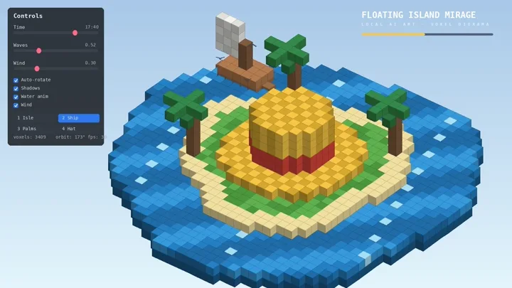
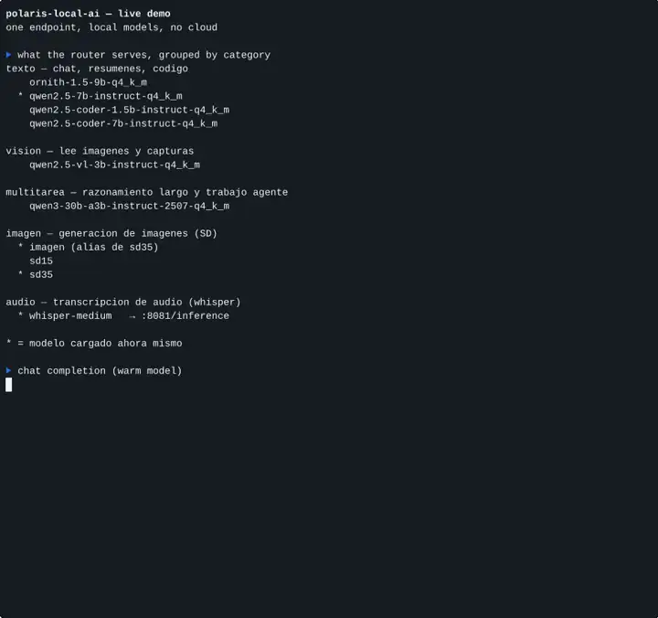

# polaris-local-ai

[English](README.md) · **Español**

<p align="center">
<a href="https://github.com/AvilaCarlosDev/polaris-local-ai/actions/workflows/ci.yml"></a>
<a href="LICENSE"></a>
<a href="https://github.com/AvilaCarlosDev/polaris-local-ai/releases"></a>
<a href="docs/HARDWARE.md"></a>
</p>

**Una pila de IA completa y local — texto, visión y generación de imágenes — en
una AMD Radeon RX 580 2048SP (8 GB de VRAM) con 32 GB de RAM.** Sin nube, sin
facturas de API. También sirve como motor de inferencia para un agente de
programación/asistente de IA (Hermes Agent).

**Lo que estás viendo:** una escena de demostración renderizada y codificada en la RX 580. Muestra el equipo haciendo trabajo real de principio a fin, no la salida de un modelo por sí sola.

<p align="center"><a href="https://github.com/AvilaCarlosDev/polaris-local-ai/releases/download/v0.2.0/hero-scene-720.mp4"></a><br>
<sub><a href="https://github.com/AvilaCarlosDev/polaris-local-ai/releases/download/v0.2.0/hero-scene-720.mp4">FLOATING ISLAND MIRAGE (29 s)</a> — 870 frames renderizados y codificados en la máquina local, título generado por el qwen2.5-7b local</sub></p>

**Segundo clip:** un comando lista todos los modelos que sirve el router, una petición de chat se responde en 6,1 s y arranca una generación de imagen con SD 3.5. Todo corre en la RX 580; nada sale de la máquina.

<p align="center"><a href="https://github.com/AvilaCarlosDev/polaris-local-ai/releases/download/v0.2.0/hero.mp4"></a><br>
<sub><a href="https://github.com/AvilaCarlosDev/polaris-local-ai/releases/download/v0.2.0/hero.mp4">video completo (29 s)</a> — una corrida real: 57 s de reloj, reproducido a 2×</sub></p>

> **Inspirado en [Strata](https://github.com/Niko1221/Strata).**
> Strata demostró que un stack de inferencia local serio se puede empaquetar
> para que una persona normal lo ejecute en una PC normal. Este repositorio
> sigue esa misma idea: un script de instalación, una API compatible con OpenAI
> en localhost, documentación con números reales — pero para hardware más
> antiguo y con otro motor. Aquí no hay código de Strata. Créditos a su autor
> por el concepto y por el estándar que fijó.
> Ver [NOTICE](NOTICE) para el aviso de atribución completo.

---

## Por qué existe

Strata apunta a tarjetas de 12 GB o más, de la serie RX 6800 en adelante, y su
ruta AMD requiere ROCm 7, que dejó atrás la arquitectura Polaris hace años. Una
RX 580 — todavía muy común — queda fuera de su alcance.

A esta pila eso no le importa. Corre sobre **Vulkan a través del driver RADV de
Mesa**, que soporta Polaris perfectamente, y se apoya en **32 GB de RAM del
sistema** para los modelos que no caben en 8 GB de VRAM. El resultado: cinco
modelos de texto/visión —hasta dos MoE de 35 B con 3 B activos— y dos modelos
de imagen, todos accesibles a través de un único endpoint compatible con OpenAI.

## Qué obtienes

| | |
|---|---|
| **Texto** | 4 modelos, desde un coder de 1.5 B hasta Qwen3.6-35B-A3B y Ornith 1.5 35B-A3B (MoE, 3 B activos), intercambiados bajo demanda |
| **Visión** | Qwen2.5-VL 3 B con su proyector mmproj |
| **Imágenes** | SD 3.5 Medium y SD 1.5 a través de stable-diffusion.cpp, cargados bajo demanda y liberados antes de volver al texto |
| **API** | Un endpoint compatible con OpenAI, una API key, 7 ids de texto/visión + generación de imágenes |
| **Selector** | `ia-models` lista todos los ids que sirve el router, agrupados por categoría |
| **Agente** | Motor backend de OpenCode y Hermes Agent, evaluado con una matriz de tareas y correctores ocultos |
| **Huella** | Corre en un LXC de Debian sobre un host Proxmox, o en bare metal |

Los números medidos, los pasos de instalación, la guía de modelos y todo lo que
se rompió en el camino están en [`docs/`](docs/):

- [EXPECTATIONS.md](docs/EXPECTATIONS.md) — **empieza por aquí**: qué esperar y cómo usarlo bien
- [HARDWARE.md](docs/HARDWARE.md) — qué corre en esta tarjeta y qué no
- [BENCHMARKS.md](docs/BENCHMARKS.md) — tokens/segundo, cold vs warm, latencia de agente — medido
- [RELEASE-COMPARISON.md](docs/RELEASE-COMPARISON.md) — comparativa controlada y validación imagen→texto
- [MODELS.md](docs/MODELS.md) — qué modelo para cada tarea
- [SETUP.md](docs/SETUP.md) — instalación desde cero
- [PORTABLE.md](docs/PORTABLE.md) — la segunda máquina: llama.cpp en RAM normal, en una laptop sin GPU
- [HERMES.md](docs/HERMES.md) — usarlo como motor de agentes
- [LOCAL-STABILITY.md](docs/LOCAL-STABILITY.md) — límites de contexto, slots y clientes que mantienen estables a los agentes
- [TROUBLESHOOTING.md](docs/TROUBLESHOOTING.md) — los bugs que encontramos

## Últimos resultados — 25 y 26 de octubre

Medido en esta máquina, con las filas crudas en [`docs/evidence/`](docs/evidence/).
Las tablas completas están en [BENCHMARKS.md](docs/BENCHMARKS.md).

**Matriz de tareas de agente**: cinco tareas de código y extracción, calificadas
por correctores ocultos, las mismas para todos los modelos:

| Modelo | OpenCode 2.1.2 | Hermes | Uso actual |
|---|---:|---:|---|
| **Ornith 1.5 35B-A3B** | **39/40** | **39/40** | predeterminado de OpenCode; razona, así que el chat corto es más lento (38,7 s) |
| Qwen3.6-35B-A3B (+ `ngram-mod`) | 38/40 | 38/40 | respaldo rápido, sin razonamiento (chat corto 7,6 s) |
| Ornith 1.5 9B | — | 37/40 | predeterminado de Hermes |

**Qwen3.6-35B-A3B en 8 GB:** 7,2 GB de VRAM con 64 K de contexto y
`--n-cpu-moe 30`; lectura ~240 tok/s, escritura 18,8 tok/s, carga en frío 21,5 s.
La misma tarea real de OpenCode (escribir `semver.py` con pruebas) bajó de
**805 s** con la configuración vieja de Qwen3-30B a **244 s, con 23/23 pruebas en verde**.

**Decodificación especulativa (`ngram-mod`):** devolver un archivo editado pasa
de 17,0 a **27,4 tok/s**, sin modelo borrador ni VRAM extra.

**Prompt de agente más chico:** la primera petición de OpenCode bajó de 32.463
a 18.231 tokens recortando skills y herramientas del lado del cliente.

**Imágenes:** SD 3.5 Medium a 512² para borradores (61–74 s) y a 768² para la
versión final (135 s). SD 1.5 es más rápido (33 s), pero tiñe todo de rojo y magenta.

Qwen2.5 7B, Qwen2.5 Coder 7B y Qwen3-30B-A3B se retiraron el 2026-10-26; los
alias `general` y `code` ahora apuntan a Ornith 9B y Qwen3.6, así que los
clientes viejos siguen funcionando. Ver [CHANGELOG.md](CHANGELOG.md).

## Cómo se siente en la práctica

Medido en esta máquina, no estimado (corridas del 6 al 8 de octubre, con los modelos
de esa semana; la fila de imagen es de la comparativa del 22 de octubre). Mismo
prompt, mismo modelo, dos estados:

| Situación | Tiempo total |
|---|---:|
| Llamada **warm**, modelo ya cargado | **3,1 – 14,1 s** |
| Llamada **cold**, recién después de un swap | **11,0 – 55,0 s** |
| Primer mensaje a un agente, sesión nueva | **~161 s** |
| Cada mensaje posterior en esa misma sesión | **~21 – 25 s** |
| Chat justo después de generar una imagen, conversación de 23K tokens | **1,8 – 2,1 s** |

**La fila 1 vs la fila 2 es el swap** — 7,9–38,5 s para reiniciar llama-server
con los pesos nuevos. Con prompts cortos, la velocidad de generación fue la misma
en ambos estados (21–99 tok/s): la llamada fría pagó la carga, no una generación más
lenta. Mantén un solo modelo cargado durante toda la sesión y vives en la fila 1.

**La fila 2 vs la fila 3 es el agente, no la GPU.** Hermes envía un prompt de
**~20.100 tokens** (55 KB de identidad más 27 esquemas de tools), así que el
modelo se tarda ~124 s en leer tu frase antes de responderla en ~2,5 s. El
caché de prompts reduce eso a 25–71 tokens a partir del segundo turno, y ~11,7 s
de cada turno son el CLI del agente reiniciándose en cada invocación.

**La última fila es la caché KV sobreviviendo a una imagen.** Desde v0.4.0 el router
restaura la conversación antes de responder, en vez de releer 23K tokens
(~208 s antes del arreglo). Ver
[RELEASE-COMPARISON.md](docs/RELEASE-COMPARISON.md).

Desglose completo:
[BENCHMARKS.md](docs/BENCHMARKS.md) ·
[Qué esperar y cómo usarlo](docs/EXPECTATIONS.md).

## Primeros pasos

```bash
./setup.sh
```

El script verifica tu GPU, el driver Vulkan, la RAM y el disco, construye lo
que falte, instala las units de systemd y arranca el router. Los servicios de
imagen quedan apagados al arrancar; el router los inicia cuando se pide una imagen. Se niega a
continuar si tu hardware no puede correr el stack — ver
[HARDWARE.md](docs/HARDWARE.md) para los requisitos exactos.

Después:

```bash
export IA_API_KEY=your-key
curl http://127.0.0.1:8090/v1/chat/completions \
  -H "Content-Type: application/json" \
  -H "Authorization: Bearer $IA_API_KEY" \
  -d '{"model":"ornith-1.5-9b-q4_k_m",
       "messages":[{"role":"user","content":"Hello"}]}'
```

## Elegir un modelo

Preguntale al router qué sirve en lugar de adivinarlo de la documentación:

```bash
ia-models               # todos los ids, agrupados por categoría
ia-models -c vision     # una sola categoría
ia-models --json        # lista cruda para scripts
```

| Categoría | Ids | Cuándo usarla |
|---|---|---|
| `texto` | Qwen2.5 Coder 1.5 B, Ornith 1.5 9 B (y una variante `-nothink`) | chat, resúmenes, código |
| `vision` | Qwen2.5-VL 3 B | la tarea involucra una imagen |
| `multitarea` | Ornith 1.5 35B-A3B, Qwen3.6-35B-A3B (y una variante `-ngram`), 3 B activos | trabajo de agente, prompts largos, edición de código |
| `imagen` | SD 3.5 Medium, SD 1.5 | quieres una imagen |
| `audio` | whisper medium | transcripción — servicio aparte, listado solo si está instalado |

Las categorías salen del endpoint mismo (`GET /v1/models`), así que la lista
siempre dice la verdad: un `*` marca el modelo cargado en este momento, y nada
de la tabla puede desincronizarse de lo que el router corre de verdad. Los
trade-offs modelo por modelo están en [MODELS.md](docs/MODELS.md).

## Estructura del repositorio

```
router.py              Router compatible con OpenAI: intercambia modelos bajo demanda
image-mcp.py           Puente de generación de imágenes
clients/ia-imagen      CLI para generar una imagen y guardarla localmente
clients/ia-models      CLI que lista todos los modelos, agrupados por categoría
scripts/hero-demo.sh   El script detrás del video de arriba — córrelo tú mismo
scripts/bench-*.py     Benchmarks reproducibles detrás de los números de docs/
scripts/bench-agents/  Matriz de tareas de agente (OpenCode + Hermes) con correctores ocultos
scripts/bench-spec/    Mediciones de decodificación especulativa y de Bonsai 27B
systemd/               Las units que corren el stack
docs/                  Notas de hardware, benchmarks, instalación, gotchas
setup.sh               Instalador de una sola ejecución
```

## Créditos y licencia

- **[Strata](https://github.com/Niko1221/Strata)** — MIT, de su autor. La
  inspiración para el alcance y el empaquetado de este proyecto. No es un fork;
  aquí no hay código fuente de Strata.
- **[llama.cpp](https://github.com/ggml-org/llama.cpp)** — el motor de
  inferencia de texto y visión.
- **[stable-diffusion.cpp](https://github.com/leejet/stable-diffusion.cpp)** —
  el motor de imágenes.
- **[Qwen](https://qwen.ai/)**, **Ornith**, **ISTA-DASLab** — las familias de
  modelos usadas acá; cada una con su propia licencia.

Este repositorio tiene licencia MIT. Los pesos de los modelos **no** están
incluidos y conservan sus propias licencias.
